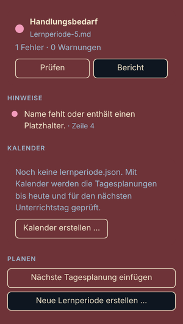
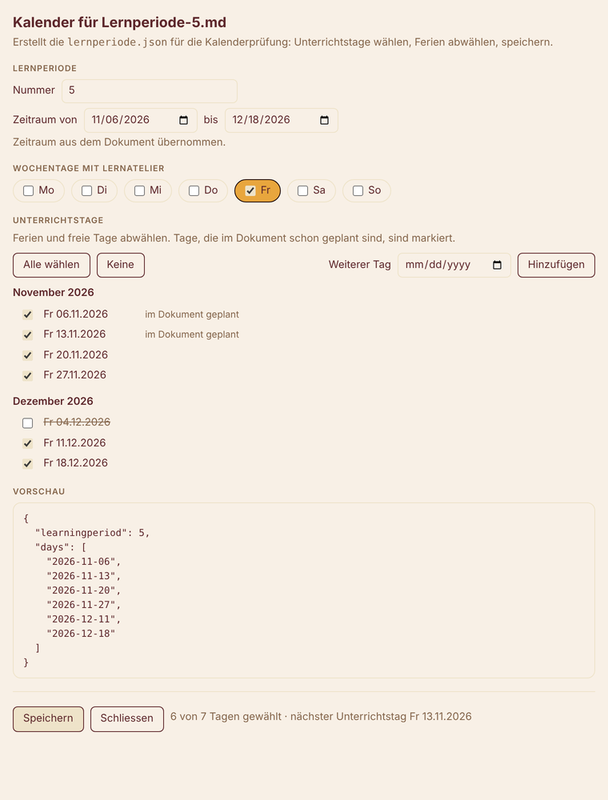

# Lernatelier Checker

Prüft deine Lernatelier-Dokumentation (`Lernperiode-N.md`) direkt beim Schreiben auf formale Vollständigkeit. Fehlende Angaben erscheinen als Hinweise in der Datei und im Bereich **Probleme**, und eine Ampel in der Statusleiste zeigt, wie weit dein Dokument ist.

Die Regeln stammen aus der Bibliothek [lernatelier-checker-js](https://github.com/djlauk/lernatelier-checker-js) von Daniel J. Lauk. Die Erweiterung verwendet sie unverändert, du bekommst also dieselben Ergebnisse wie mit dem Prüfwerkzeug der Schule.

## Was du siehst

- **Hinweise in der Datei**: Wellenlinien genau an der Stelle, an der etwas fehlt, zum Beispiel unter `- Name:`, unter einer Tagesplanung mit zu wenig Arbeitspaketen oder unter einem Arbeitspaket, das nur `...Ihr Text...` enthält.
- **Bereich „Probleme“** (`Strg`+`Shift`+`M`, auf dem Mac `Cmd`+`Shift`+`M`): alle Fehler und Warnungen mit Zeilennummer. Ein Klick springt an die Stelle.
- **Ampel in der Statusleiste**, unten links, solange eine Lernperiode-Datei offen ist:
  - grünes Häkchen: alles in Ordnung,
  - gelbes Warnzeichen: Verbesserungsbedarf (nur Warnungen),
  - rotes Fehlerzeichen: Handlungsbedarf (mindestens ein Fehler).

  Die Zahl daneben ist die Anzahl der Hinweise. Ein Klick öffnet den Bericht.
- **Kalender-Knopf in der Statusleiste**, direkt daneben: „Kalender erstellen“, solange es keine `lernperiode.json` gibt, sonst die Anzahl Unterrichtstage. Ein Klick öffnet den Kalender-Editor.
- **Seitenleiste „Lernatelier“** (Symbol mit Checkliste in der Aktivitätsleiste ganz links; fehlt es, Rechtsklick auf die Leiste und „Lernatelier“ anhaken): Ampel, **Fortschritt** (vollständige Tage, erledigte Arbeitspakete, Tagesreflexionen, Grobplanung und Lernperiodenreflexion als Balken, darunter alle Tage mit ✓ erledigt, ! unvollständig, ✗ fehlt, – abwesend, ○ später; ein Klick springt zum Tag; unter **Pro Woche** pro Kalenderwoche die fälligen Tage, erledigten Arbeitspakete und Reflexionswörter), alle Hinweise der offenen Datei (ein Klick springt zur Zeile), der Kalender mit dem nächsten Unterrichtstag, Knöpfe für Prüfen, Bericht, Kalender, nächste Tagesplanung und neue Lernperiode, und unten **Alle Lernperioden** im Ordner mit ihrer Ampel (ein Klick öffnet die Datei). Ohne offene Lernperiode kannst du dort eine öffnen oder erstellen.

  
- **Explorer**: Fertige Lernperioden (grün) bekommen ein ✓ hinter dem Dateinamen, ignorierte ein –. Dateien mit Fehlern oder Warnungen färbt VS Code selbst rot oder gelb, mit der Anzahl.
- **Erinnerung**: Mit Kalender erinnert die Erweiterung einmal am Tag, wenn die Tagesplanung für heute oder den nächsten Unterrichtstag noch fehlt. **Jetzt einfügen** setzt sie ein, **Nicht mehr erinnern** schaltet die Erinnerung aus.
- **Erste Schritte**: Eine geführte Einführung in fünf Schritten, über **Lernatelier: Erste Schritte** oder den Knopf unten in der Seitenleiste.
- **Bericht**: dieselbe Übersicht wie beim Kommandozeilen-Werkzeug, mit Zeilennummern, im Ausgabebereich „Lernatelier Checker“.

### Hinweise am Zeilenende

Am Ende der Überschriften steht grau, wie weit der Abschnitt ist, und gelb, wenn etwas fehlt:

- bei jeder Tagesplanung: `3 Arbeitspakete (3–5), 2 erledigt`
- bei jeder Tagesreflexion: `Reflexion 57/50–100 Wörter`, mit Kalender vor dem Tag `(noch nicht fällig)`
- bei den Abschnitten der Grobplanung: `67 Zeichen` oder `12/20 Zeichen`
- bei der Lernperiodenreflexion: `143/100–200 Wörter`

Die Zahlen ändern sich beim Tippen. Ausschalten mit `lernatelier.inlineHints`.

### Schnelle Korrekturen (Glühbirne)

Steht der Cursor auf einem Hinweis, erscheint die Glühbirne (oder `Cmd`+`.` / `Strg`+`.`). Je nach Hinweis:

- **Name fehlt**: „Namen eintragen …“ fragt nach deinem Namen und setzt ihn ein.
- **Nummer fehlt oder passt nicht**: Nummer aus dem Dateinamen oder aus `lernperiode.json` übernehmen.
- **Zeitraum fehlt oder passt nicht zum Kalender**: Zeitraum aus `lernperiode.json` übernehmen.
- **Tagesplanung fehlt**: die Tagesplanung für dieses Datum einfügen.
- **Datum `tt.mm.jjjj` in einer Tagesplanung**: das Datum des nächsten Unterrichtstags einsetzen.
- **Zu wenig Arbeitspakete**: fehlende Arbeitspakete als Platzhalter hinzufügen, oder den Tag als abwesend markieren.
- **Leere Tagesreflexion**: den Tag als abwesend markieren.
- **Arbeitspaket nur mit Platzhalter**: das leere Arbeitspaket entfernen.
- **Auf einer Tages-Überschrift**: offene Arbeitspakete vom Vortag übernehmen (siehe unten).

Die Korrekturen ändern nur deine Datei und lassen sich mit `Cmd`+`Z` / `Strg`+`Z` rückgängig machen.

Geprüft werden **alle** `Lernperiode-*.md` im geöffneten Ordner, auch die, die du gerade nicht offen hast; ihre Hinweise stehen alle im Bereich „Probleme“. Die Ampel in der Statusleiste zeigt immer die Datei, in der du gerade bist. Offene Dateien werden beim Tippen geprüft, die anderen, sobald sie sich auf der Festplatte ändern (zum Beispiel nach `git pull`).

### Offene Arbeitspakete übernehmen

Was du an einem Tag nicht geschafft hast (`- [ ]`, nicht abgehakt), nimmst du mit **Lernatelier: Offene Arbeitspakete übernehmen** in die nächste Tagesplanung mit:

- Genommen wird der letzte Tag bis heute mit offenen Arbeitspaketen.
- Gibt es danach schon eine Tagesplanung, ersetzen die offenen Arbeitspakete zuerst deren Platzhalter `...Ihr Text...`; was nicht mehr Platz hat, wird angehängt. Arbeitspakete, die dort schon stehen, werden nicht doppelt eingefügt.
- Gibt es noch keine, wird eine neue Tagesplanung angelegt: mit Kalender für den nächsten Unterrichtstag, sonst fragt die Erweiterung nach dem Datum.

Am Vortag bleiben die Arbeitspakete stehen, so wie du sie geplant hast. Den Befehl gibt es auch in der Seitenleiste unter **Planen** und in der Glühbirne, wenn der Cursor auf einer Tages-Überschrift steht.

### Abgeschlossene Lernperioden ignorieren

Ältere Lernperioden sollen den Bereich „Probleme“ nicht füllen. In der Seitenleiste unter **Alle Lernperioden** hat jede Datei einen Knopf **Ignorieren**, und **Ältere ignorieren** ignoriert mit einem Klick alle ausser der neusten pro Ordner. Ignorierte Dateien bleiben in der Liste (durchgestrichen) und lassen sich mit **Prüfen** wieder einschalten. Ist eine ignorierte Datei offen, steht in der Statusleiste „Lernatelier: ignoriert“; ein Klick prüft sie wieder.

Die Liste der ignorierten Dateien speichert VS Code lokal für diesen Ordner. Sie landet nicht in deinen Dateien und nicht in git.

## Was geprüft wird

- Nummer der Lernperiode in der Überschrift `# Lern-Periode N`
- `Name:` ist ausgefüllt (nicht „Exemplibus Exemplio“)
- `Zeitraum: TT.MM.JJJJ bis TT.MM.JJJJ` ist gültig
- Die vier Abschnitte der Grobplanung (Noten, Veränderungen, Projekte / neue Technologien, Generelle Ziele) enthalten je mindestens 20 Zeichen eigenen Text
- Jede Tagesplanung hat ein gültiges Datum, kommt nur einmal vor und liegt im Zeitraum
- Jede verlangte Tagesplanung hat 3 bis 5 ausgefüllte Arbeitspakete; Platzhalter zählen nicht
- Tagesreflexionen haben 50 bis 100 Wörter, die Lernperiodenreflexion 100 bis 200 Wörter
- Doppelte oder falsch eingeordnete Abschnitte werden gemeldet
- Abwesenheit: Steht direkt unter der Tagesüberschrift allein `krank`, `Krankheit`, `abwesend`, `Absenz`, `absent` oder `absence`, werden für diesen Tag keine Arbeitspakete und keine Reflexion verlangt.

Grün heisst **formal vollständig**. Die Qualität der Arbeitspakete, Ziele und Reflexionen beurteilt weiterhin deine Lehrperson.

## Kalender: lernperiode.json

Liegt im selben Ordner wie deine Lernperiode-Datei eine `lernperiode.json`, prüft die Erweiterung zusätzlich nach Kalender:

```json
{
  "learningperiod": 5,
  "days": ["2026-09-18", "2026-09-25", "2026-10-02"]
}
```

- `learningperiod`: Nummer der Lernperiode; sie muss zur Überschrift passen.
- `days`: die Unterrichtstage im Format JJJJ-MM-TT.

Mit Kalender werden Tagesplanungen bis heute und für den **nächsten** Unterrichtstag verlangt, spätere Tage dürfen noch Platzhalter enthalten. Tagesreflexionen sind am jeweiligen Tag fällig, die Lernperiodenreflexion am letzten Unterrichtstag. Ohne `lernperiode.json` wird das Dokument wie ein fertiges geprüft.

### Mehrere Lernperioden im selben Ordner

Die `lernperiode.json` gilt nur für die Lernperiode, deren Nummer in `learningperiod` steht. Alle anderen Lernperioden im Ordner werden ohne Kalender geprüft und nicht rot, nur weil Nummer oder Daten nicht passen. In der Seitenleiste steht dann, zu welcher Lernperiode die Datei gehört.

Soll auch eine ältere Lernperiode einen Kalender haben, bekommt sie ihre eigene Datei `lernperiode-N.json` (z. B. `lernperiode-4.json`). Eine `lernperiode-N.json` hat immer Vorrang vor der `lernperiode.json`. Der Kalender-Editor wählt den Dateinamen selbst: `lernperiode.json`, wenn es noch keine gibt oder sie zu dieser Lernperiode gehört, sonst `lernperiode-N.json`; der Name steht im Titel des Editors.

### Kalender-Editor

Du musst die Datei nicht von Hand schreiben: **Lernatelier: Kalender bearbeiten (lernperiode.json) …** öffnet ein Formular, auch über den Kalender-Knopf in der Statusleiste oder in der Seitenleiste.



- **Nummer und Zeitraum** werden aus deinem Dokument übernommen (`# Lern-Periode N`, `Zeitraum: … bis …`). Du kannst sie im Formular ändern.
- **Wochentage**: An welchen Tagen ist Lernatelier? Die Wochentage deiner bisherigen Tagesplanungen sind schon angewählt; mehrere Tage sind möglich.
- **Unterrichtstage**: Alle passenden Daten im Zeitraum, nach Monat gruppiert und alle angewählt. Wähle Ferien und freie Tage ab. Tage, die im Dokument schon geplant sind, sind markiert. Mit **Weiterer Tag** fügst du einen Tag ausserhalb des Rhythmus hinzu.
- **Vorschau**: So sieht die `lernperiode.json` aus. Darunter steht, wie viele Tage gewählt sind und welcher der nächste Unterrichtstag ist.
- **Speichern** schreibt die Datei und prüft dein Dokument sofort mit dem neuen Kalender.

Gibt es schon eine `lernperiode.json`, lädt der Editor sie: deine abgewählten Tage bleiben abgewählt, und der Knopf heisst **Speichern (ersetzt die bestehende Datei)**.

Es ist dasselbe Format wie beim Python-Werkzeug `lernatelier-checker`. Beim Bearbeiten der Datei schlägt VS Code die Felder vor und markiert falsche Daten.

## Befehle

Öffne die Befehlspalette (`Strg`+`Shift`+`P`, auf dem Mac `Cmd`+`Shift`+`P`) und tippe „Lernatelier“:

- **Lernatelier: Dokument prüfen** prüft die offene Datei sofort und zeigt den Bericht. Auch über das Häkchen-Symbol oben rechts im Editor.
- **Lernatelier: Bericht anzeigen** zeigt den Bericht der offenen Datei.
- **Lernatelier: Neue Lernperiode erstellen …** fragt nach der Nummer und legt `Lernperiode-N.md` aus der offiziellen Vorlage an. Bestehende Dateien werden nie überschrieben.
- **Lernatelier: Kalender bearbeiten (lernperiode.json) …** öffnet den [Kalender-Editor](#kalender-editor).
- **Lernatelier: Lernperiode öffnen …** zeigt alle `Lernperiode-*.md` im Ordner zur Auswahl.
- **Lernatelier: Alle Lernperioden im Ordner prüfen** prüft den ganzen Ordner neu.
- **Lernatelier: Diese Lernperiode ignorieren** / **Diese Lernperiode wieder prüfen** und **Ältere Lernperioden ignorieren**, siehe oben.
- **Lernatelier: Woche planen** fügt die Tagesplanungen für alle Unterrichtstage der nächsten 7 Tage ein, die noch fehlen. Mit Kalender sind das dessen Tage (in den Ferien die Woche ab dem nächsten Unterrichtstag), ohne Kalender die Wochentage, an denen du bisher geplant hast.
- **Lernatelier: Offene Arbeitspakete übernehmen** kopiert die nicht abgehakten Arbeitspakete des letzten Tages in die nächste Tagesplanung, siehe [oben](#offene-arbeitspakete-übernehmen).
- **Lernatelier: Erste Schritte** öffnet die geführte Einführung.
- **Lernatelier: Nächste Tagesplanung einfügen** fügt vor „Lernperiode Reflexion“ eine neue Tagesplanung mit drei leeren Arbeitspaketen und einer Tagesreflexion ein. Mit `lernperiode.json` nimmt sie den nächsten Unterrichtstag, der noch fehlt, sonst fragt sie nach dem Datum.

## Snippets

Tippe in einer Markdown-Datei eines dieser Wörter und wähle den Vorschlag mit Enter:

- `lernperiode`: die ganze offizielle Vorlage. Mit Tab springst du zu Nummer, Name, Zeitraum (Beginn, Ende) und zum Datum der ersten Tagesplanung.
- `planung` (oder `tag`): eine neue Tagesplanung mit dem heutigen Datum, drei Arbeitspaketen und der Tagesreflexion.
- `tagesreflexion`: die Überschrift der Tagesreflexion mit Platzhalter.
- `arbeitspaket` (oder `ap`): eine neue Checkbox.

Die Platzhalter `...Ihr Text...` zählen nicht als ausgefüllt, der Checker zeigt sie also an, bis du sie ersetzt hast.

In Markdown-Dateien schlägt VS Code Snippets nicht von selbst vor: Drücke nach dem Wort `Strg`+`Leertaste` (auf dem Mac `Ctrl`+`Leertaste`) oder wähle **Snippet einfügen** in der Befehlspalette. Wer die Vorschläge immer will, setzt in den Einstellungen `"[markdown]": { "editor.quickSuggestions": { "other": "on" } }`.

## Einstellungen

- `lernatelier.enable`: automatisch prüfen (Standard: an)
- `lernatelier.filePattern`: welche Dateien geprüft werden (Standard: `**/Lernperiode-*.md`)
- `lernatelier.checkWhileTyping`: schon beim Tippen prüfen (Standard: an); aus = nur beim Öffnen und Speichern
- `lernatelier.checkWorkspace`: alle Lernperiode-Dateien im Ordner prüfen (Standard: an); aus = nur offene Dateien
- `lernatelier.inlineHints`: Hinweise am Zeilenende anzeigen (Standard: an)
- `lernatelier.explorerBadges`: ✓ und – im Explorer anzeigen (Standard: an)
- `lernatelier.reminder`: tägliche Erinnerung an die fehlende Tagesplanung (Standard: an)

## Datenschutz

Die Erweiterung liest nur die Lernperiode-Dateien im geöffneten Ordner und die `lernperiode.json` daneben. Sie sendet nichts ins Internet, sammelt keine Daten und schreibt nur, wenn du einen der Befehle zum Erstellen oder Einfügen ausführst. Details stehen in [PRIVACY.md](PRIVACY.md).

## Hilfe und Fehler melden

Fragen und Fehler bitte als [GitHub Issue](https://github.com/JestingDart4369/lernatelier-checker-vscode/issues) melden, siehe [SUPPORT.md](SUPPORT.md). Wenn eine Regel deiner Meinung nach falsch prüft, ist das meist eine Frage an die Bibliothek: [lernatelier-checker-js](https://github.com/djlauk/lernatelier-checker-js).

## Lizenz

MIT, siehe [LICENSE](LICENSE). Die enthaltene Bibliothek lernatelier-checker-js und alle weiteren Bestandteile sind in [THIRD-PARTY-NOTICES.md](THIRD-PARTY-NOTICES.md) mit ihren Lizenzen aufgeführt.
